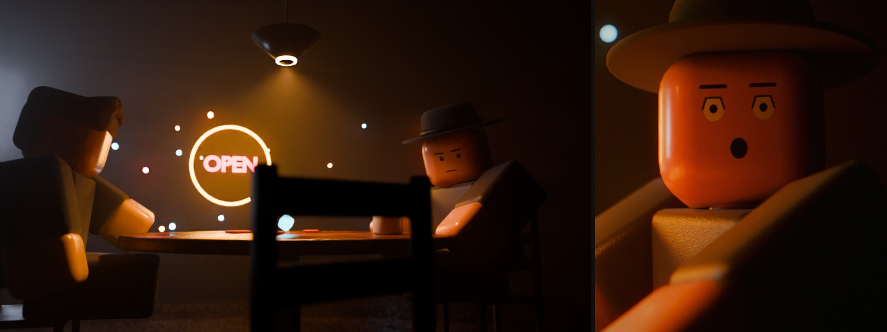

# robloxcinematic

A Claude Code and Antigravity skill for making **cinematic shorts with blocky Roblox-style characters** in Blender Cycles. Think toy figures with hand-drawn expressions, a photoreal miniature set, and cuts that land on the beat.



*Standoff — four shots, 100 BPM, and one glowing gem. Rendered in Blender Cycles from the [included demo scene](examples/standoff/build.py).*

## Highlights

- **Direct the performance.** Snap into a pose and hold it, swap drawn expressions, and use short lines of dialogue only when the shot calls for them. See the [Blender toolkit](blender/cine_kit.py).
- **Light it like a miniature.** Use visible pendants and neon, shallow focus, haze, and materials such as toy plastic, worn wood, and wet asphalt. See the [lighting and lens recipes](references/look.md).
- **Cut on the beat.** Map a track with [beatgrid](scripts/beatgrid.py) and measure shot lengths in seconds, frames, and beats with [shotlist](scripts/shotlist.py).
- **Finish and check the look.** Apply one of five [finishing looks](scripts/finish.py) in ffmpeg, then use the [look gate](scripts/look_gate.py) to check brightness, shadows, highlights, and saturation.

For game assets and brighter explainer worlds, see the companion project [robloxmaxxing](https://github.com/aaksa/robloxmaxxing). The [craft notes](references/craft.md) and [reference-film studies](references/reference-films.md) cover the decisions behind the cinematic look.

## How I use Meshy to make models

- **[Meshy Agent](https://docs.meshy.ai/en/webapp/3d-agent):** I use it to explore character and prop ideas, refine visual concepts in chat, and turn the concepts I choose into 3D models.
- **[Meshy MCP](https://docs.meshy.ai/en/api/ai):** When I’m working in an MCP-enabled assistant like Claude Code, I use it to generate models from prompts or reference images and download the results without leaving that workflow.

Once I have a model, I export it as a **GLB** and import it into Blender. Meshy is the asset-creation step; `robloxcinematic` is where I pose the cast, light the set, frame the shots, and cut the film. Meshy is optional: the included Standoff demo uses its own blocky cast and runs without a Meshy account or API key.

## Install

Needs Blender 5.x, Python 3, and ffmpeg. Tested on Blender 5.1.2 on macOS (Apple M4).

```bash
git clone https://github.com/aaksa/robloxcinematic.git
cd robloxcinematic
bash install.sh                 # Claude Code
# bash install.sh --antigravity # Antigravity instead
```

## Try it
```bash
B=/Applications/Blender.app/Contents/MacOS/Blender
"$B" -b --factory-startup -P examples/standoff/build.py -- --out examples/standoff/out --stills
python3 -I scripts/finish.py examples/standoff/out/still_master.png --out examples/standoff/out/fin_master.jpg --look amber
python3 -I scripts/look_gate.py examples/standoff/out/fin_master.jpg --look amber
```

## Credits and limits
The look was studied from two films by GibbsonTV ("Liar's Bar - Roblox Animation", "Fugitive - Roblox Animation"). This skill
measures their craft; it does not contain or reproduce their characters, sets, story or music, and films made with it must not
either. The reference frames used during the study are not part of this repository. Roblox is a trademark of Roblox Corporation;
this project is not affiliated with it.

MIT licence.
